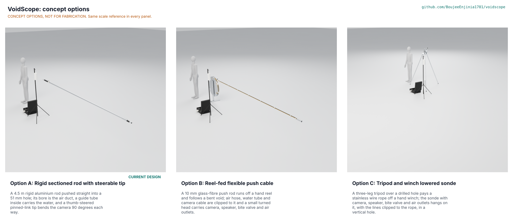

# VoidScope concept options

Option A, the rigid sectioned rod with a steerable tip (the design of record), scores 165 against 135 for option B and 128 for option C, 22 per cent clear of the runner-up; it is recommended, and the choice is Proposed, awaiting Amish (VDS-DDR-005). Method: STANDARDS section 21.

*Figure 1. The three options at one scale. The picture is rendered from the D3 models in `cad/src/model.py` by `.kit/options.py`; the coordinator renders it on Amish's Mac, so it is absent until then.*

> **Safety:** All three options are paper concepts for rescue equipment that may supply water and air to a trapped person. None is safe to use as drawn. VoidScope is an open engineering reference, not certified rescue equipment and not a medical device.

## The options

### Option A: rigid sectioned rod with a steerable tip (design of record)

*Working principle: push a rigid rod straight through the hole and look round corners with a steerable camera tip.* A 4.5 m rod of four 38.1 mm aluminium sections joined by snap buttons; its bore is the air duct and a guide tube inside carries the single-use water tube to a bite valve on the nose; a turned 48 mm head, a pinned-link tip bent by two wires from a thumb lever. First-order numbers: 4.13 m working length (tip rested on debris beyond about 2 m), 48 mm head, rod buckles at 940 N, 2.2 min setup, USD 1,780 (VDS-CAL-001). Key risks: the tip heat (fixed, STM S14), the drip margin (fixed, S7), the wire breaking load and the bite valve, all to confirm when parts are bought. Needs from a co-design partner: a medical lead to review the water and air lines, and training rubble.

### Option B: reel-fed flexible push cable

*Working principle: feed a flexible rod off a reel and let it follow the void.* A 10 mm glass-fibre rod, 5.2 m, wound on a 640 mm hub between two 800 mm aluminium flanges; the air hose, water tube and camera cable are clipped beside the rod every 650 mm; a turned 40 mm head carries the camera, speaker, bite valve and six air outlets as in A, without a steerable tip. First-order numbers: strain on the reel 1.5 per cent (STM SB2, plausible); the rod droops 93 mm at 1 m in free air (STM SB1), so it reaches 4 m only where the void floor carries it. Key risks: reach in free air, a loaded rod springing back, lines outside the rod catching on rebar, a heavy reel to carry (the modelled kit weighs 26.6 kg against 11.8 kg for A). Needs: trials in a floor-supported void to learn how far it really goes.

### Option C: tripod and winch lowered sonde

*Working principle: lower a camera sonde on a rope down a vertical hole, as a borehole camera is.* Three 32 x 2 mm aluminium legs pinned to a head plate over the hole; a hand winch (drum, crank, ratchet and pawl) pays a 4 mm stainless rope; a 44 x 360 mm sonde hangs on an eye bolt, camera down, with the lines clipped to the rope. First-order numbers: depth 4 m; each leg takes 4.5 kN before it buckles against 150 N needed (STM SC1). Key risks: it works only down a vertical hole, the sonde spins and swings on its rope, a hanging load above a survivor. Needs: a vertical drilled hole and a medical lead's view on offering water to a swinging valve.

## First-order numbers

*Table 1. Options compared. Parts counts, masses and step files are from `cad/fidelity.json` (kit 1.9, D3; mass includes the shared surface unit and stand).*

| Quantity | Option A | Option B | Option C |
| --- | --- | --- | --- |
| Estimated parts cost (USD) | 1,780 (bom/bom.csv) | 999 shared with A, plus probe parts to quote | 999 shared with A, plus probe parts to quote |
| Mass (kg), modelled | 11.8 | 26.6 | 15.5 |
| Output or throughput | 4.13 m horizontal reach, tip steers 90 degrees each way | 1 m free reach; up to 5.2 m of rod where the floor carries it | 4 m depth, vertical hole only |
| Energy or effort | One 12.8 V 6 Ah pack, 6.2 h video; hand push | Same unit; hand push and reel | Same unit; hand winch |
| Parts count (D3 model) | 143 | 125 | 143 |
| STEM check | 22 rows, 11 within, 11 plausible; S14 tip heat and S7 capillary margin fixed | SB1 restated (free reach capped at 1 m); SB2 plausible | SC1 within; SC2 plausible |

## Scoring

*Table 2. Weighted scoring (weights: High UR 3, Medium 2, Low 1; scores 1 to 5; the last four rows are the STANDARDS section 21 criteria).*

| Criterion | Source | Weight | A | B | C | Reason |
| --- | --- | --- | --- | --- | --- | --- |
| Fits a 50 mm hole | UR-001 | 3 | 4 | 5 | 4 | A head 48 mm leaves 1.5 mm a side; B head 40 mm and a 10 mm rod; C sonde 44 mm |
| Reaches 4 m along a straight path | UR-002 | 3 | 5 | 2 | 3 | A 4.13 m rigid; B 1 m free, floor-supported only (STM SB1); C 4 m deep but vertical only |
| Sees in darkness and dust | UR-003 | 3 | 4 | 4 | 4 | Same bought camera in all three |
| Survives rubble handling | UR-004 | 3 | 4 | 3 | 3 | A aluminium rod and housing; B glass-fibre rod splinters and abrades; C rope abrades on the hole edge |
| Water cannot harm the survivor | UR-005 | 3 | 4 | 3 | 2 | Same capillary and bite valve; A can steer the tip aside; B has no steering; C sonde swings and spins on its rope, so the valve is hard to offer |
| Air clean and gentle | UR-006 | 3 | 5 | 3 | 3 | A uses the 35 mm bore as the duct (0.38 kPa); B and C use a 10 to 12 mm hose clipped alongside |
| Works a whole shift | UR-007 | 3 | 4 | 4 | 4 | Same surface unit and packs in all three |
| Looks round a corner | UR-011 | 3 | 4 | 3 | 1 | A steers 90 degrees each way; B follows a bend with the rod but cannot aim; C has no steering |
| Affordable for a municipal budget | UR-008 | 3 | 4 | 3 | 4 | A USD 1,780 (BOM); B and C share USD 999 of A's lines; their probe parts are not priced (to quote); B adds a reel and welded upright, C a winch and tripod |
| Quick to set up and carry | UR-009 | 2 | 3 | 2 | 3 | A 2.2 min; B reel adds mass (kit 20.2 kg); C tripod set over the hole |
| Water path stays clean | UR-010 | 2 | 4 | 3 | 3 | A water tube runs inside a guide tube; B and C clip it outside, where rubble touches it |
| Talks with the survivor | UR-012 | 2 | 4 | 4 | 4 | Same tip speaker in all three |
| Nothing hot or hazardous at the tip | UR-013 | 2 | 4 | 4 | 4 | Same camera and the same black anodised finish (STM S14) |
| Buildable with local skills and tools | STANDARDS 21 | 2 | 3 | 3 | 3 | A needs outside lathe time; B needs welding and a reel; C needs a built winch with pawl |
| Safety (structure, hanging loads, stops) | STANDARDS 21 | 3 | 4 | 3 | 2 | C hangs a weight and rope over a possible survivor; B's rod can spring back; A has the blocked-tip stop and is steerable out |
| Maintenance | STANDARDS 21 | 1 | 3 | 4 | 4 | B and C have fewer, simpler parts to replace |
| **Weighted total (of 205)** | | | **165** | **135** | **128** | A leads B by 22 per cent and C by 29 per cent |

## Recommendation

Recommended: option A. It is the only option that reaches 4 m horizontally, aims the camera and uses the rod bore as a clean air duct, and it scores 22 per cent above B and 29 per cent above C, outside the 10 per cent band, so one option goes forward as a proposal. This is the design of record and nothing is redesigned. Recorded in VDS-DEC-001 as "Proposed, awaiting Amish" and argued in VDS-DDR-005; `project.yaml` says `concept_chosen: A (proposed)`.

Best ideas to graft onto A from the others: from B, the reel concept for a long water and camera umbilical (the 7 m cable and 8 m tube today lie loose on the ground); from C, a tripod head plate as an optional guide for pushing the rod into a vertical hole, which makes a vertical entry steadier. Both are suggestions, not changes.
